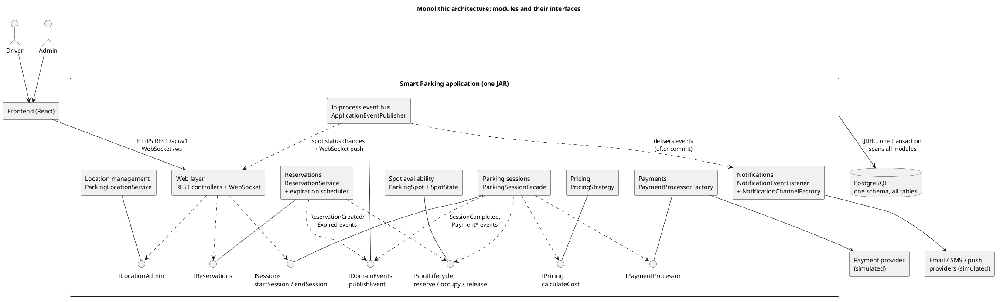
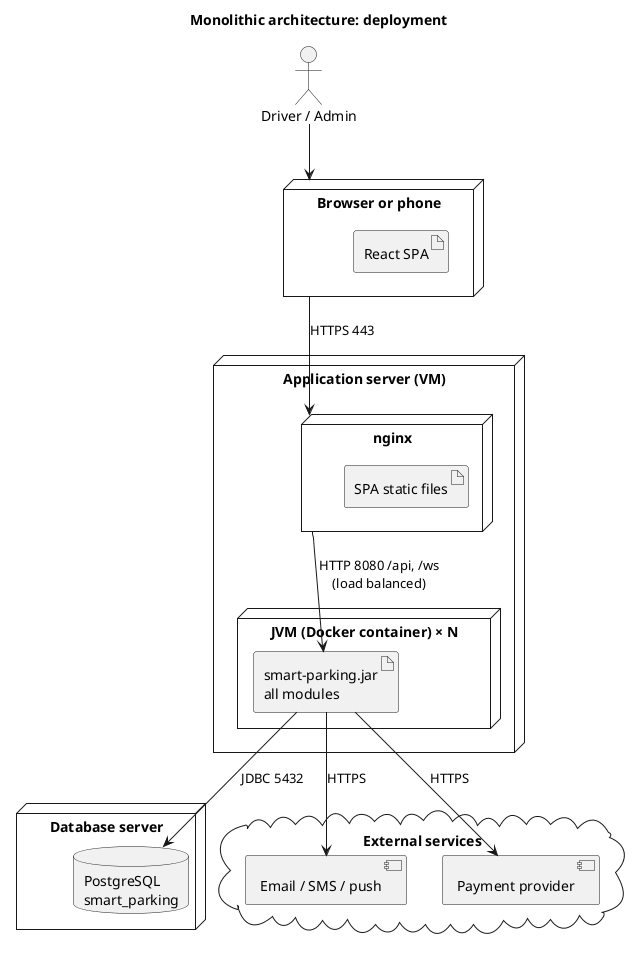
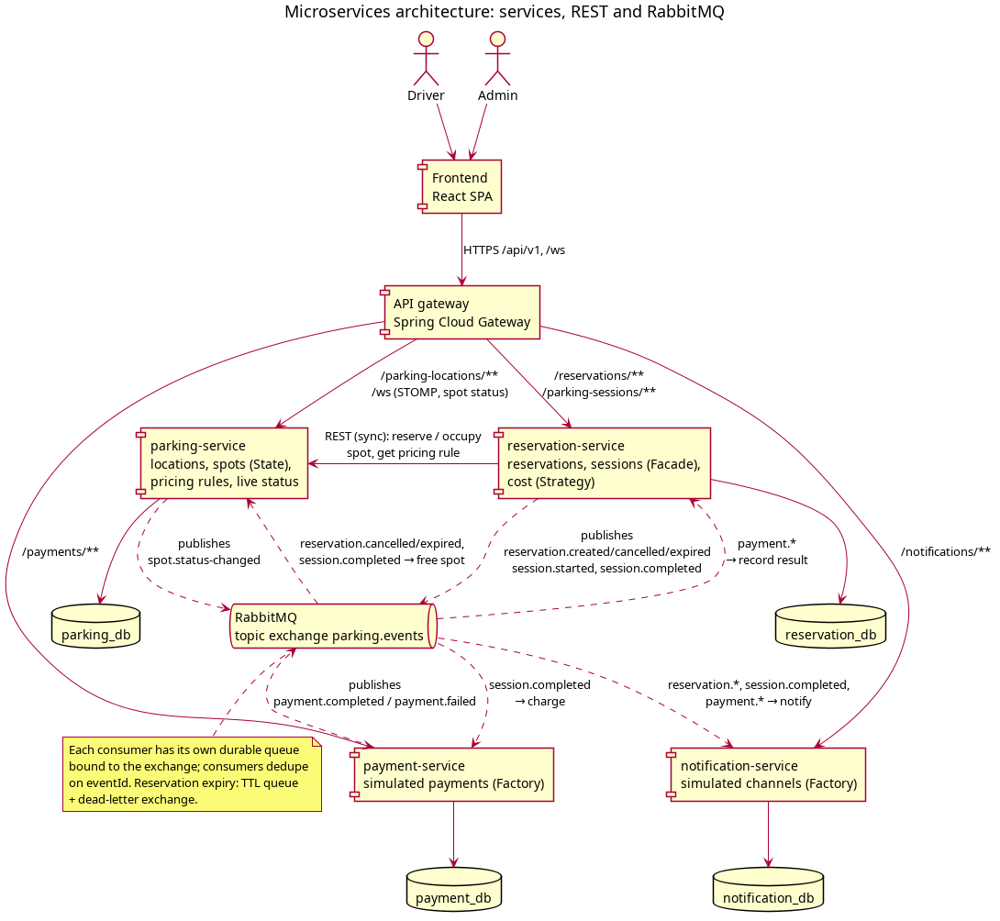
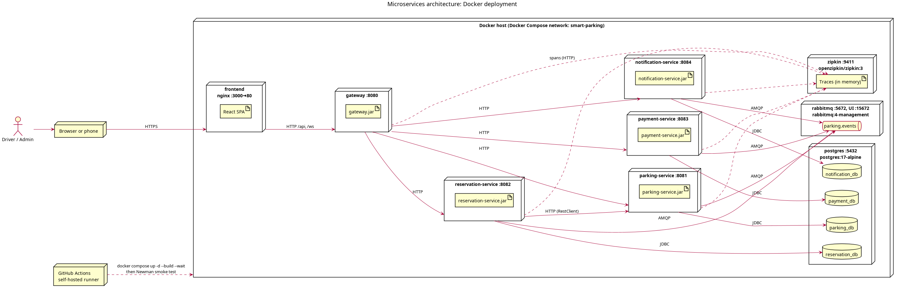
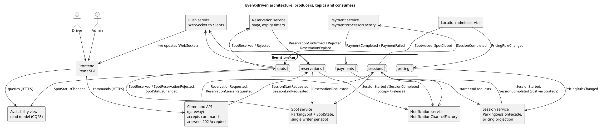
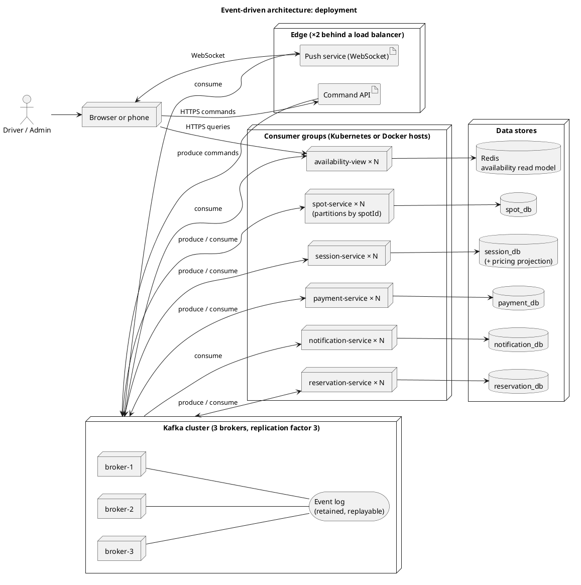

# Architecture (exercise 6)

This document compares three ways to build the Smart Parking Management System: a monolith,
microservices, and an event-driven architecture. The domain, the business rules and the five
design patterns (`docs/design-patterns.md`) are the same in all three. What changes is where
the boundaries are, how the parts talk to each other, and who owns which data.

Each architecture is described by its structure, a component diagram, a deployment diagram,
the two main flows (reserving a spot, and parking then paying), and its pros and cons. The
document ends with a comparison and a recommendation.

Diagram sources are in `diagrams/architecture/`; the images below are rendered from them.

---

## 1. Monolithic architecture

### Structure

One Spring Boot application, deployed as one artifact, with one database. Inside, the code is
split into modules by feature. Modules call each other through interfaces in the same process
and announce changes through Spring's in-process event bus (`ApplicationEventPublisher`).
This is the structure of the Stage 1 proof of concept in `poc/`.

| Module | Responsibility | Patterns |
|---|---|---|
| Web layer | REST controllers, WebSocket for live spot status | Facade client |
| Location management | Locations, spots, pricing rules | |
| Spot availability | Spot lifecycle | State |
| Pricing | Cost of a stay | Strategy |
| Reservations | Reserve, cancel, expire (scheduled check) | Observer publisher |
| Parking sessions | Start and end sessions | Facade, Observer publisher |
| Payments | Simulated card and wallet payments | Factory |
| Notifications | Email, SMS and push (simulated) | Observer, Factory |

### Data flow

**Reserving a spot.** The driver's request reaches `ReservationController` →
`ReservationService.reserve()`. In one database transaction the service loads the spot, asks its
state to reserve it (`AvailableState` allows it; every other state throws, which becomes `409`),
saves the reservation, and publishes `ReservationCreatedEvent`. Two drivers racing for the same
spot are separated by the spot's `@Version` column and the unique index on active reservations:
the second commit fails and gets `409`. After the commit, the notification module receives the
event and notifies the driver. A scheduled job expires unused reservations every minute.

**Parking and paying.** `ParkingSessionFacade.startSession()` occupies the spot and opens a session.
`endSession()` then runs everything in one transaction: exit time, cost from the location's
pricing strategy, payment through the processor factory, spot released, events published. A
failure anywhere rolls the whole thing back.

### Pros

- **Simplest to build, test and debug.** One codebase, one process, one log, stack traces that
  cover the whole flow.
- **Strong consistency for free.** Reserving a spot and ending a session are single local
  transactions; no distributed failure cases.
- **Cheapest to run.** One application container and one database.
- **Fast in-process calls,** no network hops between modules.

### Cons

- **Scales as one block.** Availability reads (by far the most frequent request) can only be
  scaled by running more copies of the whole application, and every copy uses the same database.
- **No fault isolation.** A memory leak in notifications, or a slow payment provider holding
  threads, affects reservations too.
- **One release for everything.** Changing a notification template redeploys the reservation
  code.
- **Boundaries erode over time.** Nothing stops one module from reading another's tables, so
  the modules slowly couple.

---

## 2. Microservices architecture

### Structure

This is what Stage 2 builds (`docker-compose.yml`). Five deployables, each with its own database:

| Service | Owns | Synchronous API (via the gateway) | Publishes | Consumes |
|---|---|---|---|---|
| gateway | — | Routes `/api/v1/**`, `/ws` | — | — |
| parking-service | `parking_db` | Locations, spots, pricing rules, availability; STOMP `/topic/spot-status` | `spot.status-changed`, `spot.closed` | `reservation.cancelled`, `reservation.expired`, `reservation.changed`, `session.completed` |
| reservation-service | `reservation_db` | Reservations, sessions | `reservation.*` (incl. `reservation.expiring` reminders), `session.started`, `session.completed` | `payment.*`, `spot.closed` |
| payment-service | `payment_db` | Payments | `payment.completed`, `payment.failed` | `session.completed` |
| notification-service | `notification_db` | Notifications, live stream (Server-Sent Events) | `notification.sent` | `reservation.*`, `session.completed`, `payment.*`, `notification.sent` |

Services talk in two ways:

- **Synchronous REST** (`RestClient` with timeouts) when the caller needs an answer before it
  can reply: reservation-service asks parking-service to reserve or occupy a spot, and reads a
  location's pricing rule. Resilience4j wraps these calls: a call without an answer is retried
  (safe, because each names its hold id and parking-service treats a repeat as already done), and a
  circuit breaker stops calling a parking-service that keeps failing.
- **Asynchronous events** on the RabbitMQ topic exchange `parking.events` for everything that
  can happen afterwards: notifications, payments, spot status updates. Each consumer has its own
  durable queue and ignores events it has already processed (dedupe on `eventId`).

Every service sends tracing spans to Zipkin (Micrometer Tracing). The trace id travels with each
HTTP request and RabbitMQ message, so one driver action is one trace across all the services it touched.

### Data flow

**Reserving a spot.**

1. The gateway routes `POST /reservations` to reservation-service.
2. reservation-service calls parking-service to reserve the spot, naming the new reservation's id
   as the spot's hold. parking-service applies the State pattern and its `@Version` check in
   `parking_db`, answers `409` if the spot isn't free, and publishes `spot.status-changed`, which
   reaches open browsers over WebSocket.
3. reservation-service saves the reservation in `reservation_db` (unique index on active
   reservations per spot). The two databases can't share a transaction, so if this save fails,
   reservation-service calls parking-service again to release the spot (a compensating action).
4. reservation-service publishes `reservation.created` and answers `201`. notification-service
   notifies the driver. (If reservation-service crashed exactly between steps 2 and 3, the spot would
   stay held without a reservation. The prototype accepts this rare case; a production system would
   time out holds that no reservation confirms.)
5. Expiry: each reservation also sends a message to a queue with a 15-minute TTL. When it
   expires, the dead-letter exchange delivers it to reservation-service, which expires the
   reservation if it is still active and publishes `reservation.expired`; parking-service frees
   the spot (only if that reservation still holds it) and the driver is notified. A scheduled
   sweep every minute catches any reservation whose timer message was lost.

**Parking and paying.**

1. Starting a session: reservation-service asks parking-service to occupy the spot (sync; the
   session becomes the spot's hold), saves the session and publishes `session.started`.
2. Ending it: `ParkingSessionFacade` in reservation-service records the exit time, fetches the
   location's pricing rule from parking-service and computes the cost with the matching strategy,
   then publishes `session.completed` and answers straight away.
3. Three services react on their own: parking-service frees the spot; payment-service charges the
   driver with the processor from its factory and publishes `payment.completed` or `payment.failed`;
   notification-service tells the driver. reservation-service stores the payment result on the
   session, and a failed payment can be retried from the receipt.

Payment is the one step that moves out of the facade's transaction compared to the monolith:
the session ends immediately and the payment follows a moment later.

### Pros

- **Independent scaling.** parking-service, which serves availability and live status, can
  run more instances than payment-service.
- **Fault isolation.** If notification-service is down, reservations still work; its events wait
  in its queue and are delivered when it restarts.
- **Independent deployment and ownership.** Each service builds, tests and ships on its own
  (CI matrix per service), and each team member can own one.
- **Clear data ownership.** No service can read another's tables, so the boundaries hold.
- **The right tool per interaction:** strong consistency where it matters (locking a spot), loose
  coupling where it doesn't (side effects).

### Cons

- **Distributed failures.** Network calls can time out; reserving a spot spans two databases and
  needs a compensating action.
- **More moving parts.** Gateway, broker, five databases, health checks, configuration per service.
- **Harder debugging.** One user action leaves logs in several services; it needs distributed
  tracing (here Zipkin, plus trace ids in every log line) to follow it.
- **Duplicated plumbing.** Every service repeats error handling, Flyway, Docker and CI setup.
- **Synchronous coupling remains:** if parking-service is down, nobody can reserve.

---

## 3. Event-driven architecture

### Structure

Events are the only way services integrate; no service calls another. Clients send *commands*
to a thin Command API, which publishes them and answers `202 Accepted` straight away. Results
reach the client later, over WebSocket.

- **Topics per aggregate:** `reservations`, `spots`, `sessions`, `payments`, `pricing`, kept in a
  replicated, replayable log (Kafka in the deployment diagram).
- **Single writer per spot:** the `spots` topic is partitioned by `spotId`, so all events for one
  spot are processed in order by one spot-service instance. Two reservations for the same spot are
  simply handled one after the other; the second sees `ReservedState` and is rejected, with no
  database locking.
- **Choreographed saga** for reservations: no service coordinates the others; each reacts to the
  previous event.
- **Read models (CQRS):** the availability view is a separate service that builds a fast
  queryable copy of spot statuses (Redis) from `SpotStatusChanged` events. The session service
  keeps its own projection of pricing rules from `PricingRuleChanged` events.

### Data flow

**Reserving a spot.**

1. `POST /reservations` → the Command API publishes `ReservationRequested` and returns `202` with
   the reservation ID. The app shows "Reserving…".
2. spot-service consumes it and asks the spot's state to reserve: `SpotReserved` or
   `SpotReservationRejected`, plus `SpotStatusChanged`.
3. reservation-service consumes the result and publishes `ReservationConfirmed` (and schedules a
   delayed expiry event) or `ReservationRejected`.
4. The push service sends the outcome to the driver's app; notification-service sends the message;
   the availability view updates.
5. Expiry: the delayed event arrives after 15 minutes; if the reservation is still unused,
   reservation-service publishes `ReservationExpired` and spot-service frees the spot.

**Parking and paying.** `SessionStartRequested` → spot-service occupies the spot → session-service
records `SessionStarted`. `SessionEndRequested` → session-service computes the cost from its
pricing projection (Strategy) → `SessionCompleted` → spot-service frees the spot and payment-service
charges (Factory) → `PaymentCompleted` / `PaymentFailed` → notification and push.

### Pros

- **Loosest coupling.** Producers don't know their consumers; a new feature (analytics,
  occupancy forecasts) is a new consumer, with no change to existing services.
- **Highest availability for writes.** Commands are accepted as long as the broker is up, even if
  spot-service is restarting; work resumes from the log.
- **Natural fit for real-time updates.** Every state change is already an event that can be
  pushed to clients.
- **Replay and audit.** The event log is a full history; read models can be rebuilt, and bugs
  reproduced, by replaying events.
- **Scales by partitions.** Adding consumers to a group spreads the load.

### Cons

- **Eventual consistency in the user experience.** The driver gets "Reserving…" instead of an
  immediate yes or no; the UI needs pending, confirmed and rejected states for every action.
- **Sagas are hard to reason about.** The reservation flow is spread across three services with no
  single place to read it; compensations and timeouts must be designed explicitly.
- **Operationally heavy.** A replicated broker cluster, schema evolution for events, consumer lag
  monitoring, dead-letter handling.
- **Harder testing.** Correctness depends on event order, duplicates and redelivery; end-to-end
  tests need the broker.
- **Overkill for this scale.** A city's car parks produce a modest event rate.

---

## 4. Comparison

| Criterion | Monolith | Microservices (REST + events) | Event-driven |
|---|---|---|---|
| **Scalability** | Whole app scales as one; one shared database | Per service; availability reads scale on their own | Per consumer group and partition; highest ceiling |
| **Real-time updates** | WebSocket from the app, fed by in-process events | `spot.status-changed` relayed over STOMP | Every change is an event; push is natural |
| **Consistency for reservations** | Strong: one local transaction | Strong at the spot (parking-service + DB guards); compensation across two databases | Eventual: saga with pending state; ordering per spot instead of locks |
| **Complexity** | Low | Medium: network calls, broker, DB per service | High: sagas, projections, event versioning |
| **Deployment** | One artifact and one database | Six containers, Docker Compose, CI per service | Broker cluster, many consumer groups, extra stores |
| **Team effort (3 people, one semester)** | Lowest; but one shared codebase to coordinate | Moderate; one service per person fits well | Highest; most effort goes into infrastructure, not features |
| **Fault tolerance** | One failure can take everything down | Isolated failures; queued events survive outages; sync calls still couple | Best: services fail and catch up from the log |
| **Testing and debugging** | Easiest | Per-service tests + Testcontainers; tracing across services | Hardest: ordering, duplicates, replay |
| **Response to the driver** | Immediate | Immediate (`201` or `409`) | Deferred (`202`, result pushed later) |

---

## 5. Recommendation

We recommend the **microservices architecture with RabbitMQ events for side effects**, the design
in section 2 that Stage 2 implements.

1. **A reservation needs an immediate, correct answer.** The no-double-reservation rule is the
   most important in the system. Keeping the spot's state and its guards (State pattern,
   `@Version`, unique index) inside the one service that owns spots, and calling it
   synchronously, gives the driver a definite yes or no at once. The event-driven saga would
   turn that into "Reserving…" followed by a pushed result, which adds UI states and failure
   cases without making the rule safer.
2. **Side effects tolerate delay, so they go through events.** Notifications, payments and status
   propagation don't need to finish before the driver gets an answer. Publishing them to RabbitMQ
   gives the event-driven benefits where they pay off: a notification outage doesn't block
   reservations, and queued events are delivered later.
3. **Traffic is uneven.** Availability checks and live status far outnumber payments, so being able
   to scale parking-service on its own is useful, and impossible in a monolith.
4. **It fits the team and the course.** Five services split naturally across three people, and
   exercises 7–9 ask for exactly this: independent services, a message queue between them, Docker
   and CI/CD. The fully event-driven design would spend most of the semester on broker operations,
   sagas and projections.

**When the other two would be right.** For a single car park operator with modest traffic, a
*modular monolith* would be cheaper to run and simpler to keep consistent, and would be our
starting point for a real product. Its modules match our service boundaries, so it could be split
later. Moving further towards *event-driven* would make sense if many new consumers appeared
(analytics, forecasting, third-party integrations) and the business accepted asynchronous
confirmations.

**Risks of the recommended architecture, and how we handle them:**

| Risk | Mitigation |
|---|---|
| Reserving spans two databases | Compensating release call if saving the reservation fails (a crash between the two steps remains a known gap) |
| Late or repeated release events | Each spot remembers the reservation or session holding it; an event naming an older hold changes nothing |
| Duplicate or redelivered events | Consumers dedupe on `eventId` |
| parking-service unavailable | `RestClient` timeouts, Resilience4j retry (3 attempts) and circuit breaker (opens at 50 % failures, 30 s); a clear `503` with `Retry-After` instead of a hanging request |
| Lost messages while a consumer is down | Durable queues; events wait until the consumer restarts |
| Reservations never released | TTL queue + dead-letter exchange, with a `@Scheduled` sweeper as a fallback |

### Where the patterns live in each architecture

| Pattern | Monolith | Microservices | Event-driven |
|---|---|---|---|
| Strategy | Pricing module | reservation-service (rule from parking-service) | session-service (pricing projection) |
| Decorator | Pricing module | reservation-service (extras from parking-service's rule) | session-service (pricing projection) |
| State | Spot module | parking-service | spot-service (single writer per spot) |
| Observer | In-process events | RabbitMQ topic exchange | The whole architecture |
| Factory | Payments, notifications modules | payment-service, notification-service | payment-service, notification-service |
| Facade | Sessions module (one transaction) | reservation-service (payment becomes async) | Replaced by the saga; no single coordinator |
